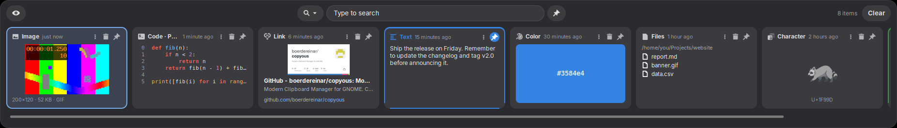

# copy-addict

Clipboard history for the Cinnamon desktop, modelled on [Copyous](https://github.com/boerdereinar/copyous) for GNOME.

Press <kbd>Super</kbd>+<kbd>V</kbd>, pick something you copied earlier, and it is pasted into the app you were using.

**On KDE Plasma?** There is a native Qt version for Plasma 6 on Wayland in [`kde/`](kde/README.md), with the same features and the same history file.



## Features

- **Every kind of copy**, each with its own card:
  - text
  - code, with syntax colours and line numbers
  - links, with a title, description and image preview
  - images, with **animated GIFs**
  - files, with an image, text or thumbnail preview
  - lists of files, colours and single characters
- **Paste on select**: Enter or a click pastes into the focused window. Terminals get <kbd>Ctrl</kbd>+<kbd>Shift</kbd>+<kbd>V</kbd>.
- **Search** that ignores accents, plus filters by type, tag and pinned items.
- **Pin and tag** items with 9 colours. Pinned and tagged items are protected and never expire.
- **Per-item menu**:
  - edit the item or its title
  - open it, or show it in its folder
  - paste as path, or convert a colour (Hex / RGB / HSL)
- **Incognito mode** pauses recording. Password-manager copies are never saved.
- **Tray icon**: left click opens the bar, middle click toggles incognito, right click opens a menu.
- **Native settings window** under *System Settings → Extensions*.
- A short sound when you copy, and a check mark on the tray icon.
- English and Brazilian Portuguese.

## Install

Requires Cinnamon 6.x on X11, plus `xdotool` and `gettext`.

```sh
sudo apt install xdotool gettext
git clone https://github.com/kbrianps/copy-addict.git
cd copy-addict
./install.sh
```

Then restart Cinnamon with <kbd>Ctrl</kbd>+<kbd>Alt</kbd>+<kbd>Esc</kbd>, or log out and back in.

`install.sh` also downloads [highlight.js](https://highlightjs.org/) 11.11.1, checking its SHA-256, into `~/.local/share/copy-addict/`. It is used for code detection and syntax colours. Skip it with `NO_HIGHLIGHT=1 ./install.sh`; code items then show as plain text.

## Keys

| Key | Action |
|---|---|
| <kbd>Super</kbd>+<kbd>V</kbd> | Open / close the bar |
| <kbd>Super</kbd>+<kbd>Ctrl</kbd>+<kbd>Shift</kbd>+<kbd>V</kbd> | Toggle incognito mode |
| <kbd>←</kbd> <kbd>→</kbd> <kbd>Home</kbd> <kbd>End</kbd> <kbd>PgUp</kbd> <kbd>PgDn</kbd> | Move between items |
| <kbd>↑</kbd> / <kbd>↓</kbd> | Go to the search box / back to the items |
| <kbd>Enter</kbd> or click | Paste |
| <kbd>Shift</kbd>+<kbd>Enter</kbd> | Copy without pasting |
| <kbd>Ctrl</kbd>+<kbd>Enter</kbd> | Default action (open link or file) |
| <kbd>Ctrl</kbd>+<kbd>S</kbd> or middle click | Pin / unpin |
| <kbd>Delete</kbd> (<kbd>Shift</kbd>+<kbd>Delete</kbd> for protected items) | Delete |
| <kbd>Ctrl</kbd>+<kbd>E</kbd> / <kbd>Ctrl</kbd>+<kbd>T</kbd> | Edit item / edit title |
| <kbd>Ctrl</kbd>+<kbd>A</kbd> or right click | Item menu (tags with <kbd>1</kbd>–<kbd>9</kbd>, <kbd>0</kbd> clears) |
| <kbd>Ctrl</kbd>+<kbd>1</kbd>…<kbd>0</kbd> | Jump to item 1–10 |
| <kbd>Ctrl</kbd>+<kbd>Tab</kbd> / scroll on the search box | Cycle the type filter |
| <kbd>Ctrl</kbd>+<kbd>Shift</kbd>+<kbd>1</kbd>…<kbd>9</kbd>, <kbd>Ctrl</kbd>+<kbd>`</kbd> | Tag filter |
| <kbd>Alt</kbd> | Show pinned items only |
| typing | Search |
| <kbd>Esc</kbd> | Clear the search, then close |

## Settings

These are in *System Settings → Extensions → copy-addict*, or in the tray icon menu.

- **History:**
  - how many items to keep
  - forget items after N minutes
  - what to keep when you log in again
  - protection for pinned and tagged items
- **Behavior:** paste or only copy on select, copy sound, tray icon.
- **Privacy:** incognito mode, and apps to ignore (by window class).
- **Appearance:** top or bottom of the screen, card size, how images fit.
- **Shortcuts:** open the bar, toggle incognito.

## Data

- **History:** `~/.local/share/copy-addict/history.json`, readable only by you. Images are kept next to it.
- **Link previews:** cached in `~/.cache/copy-addict/`.

## Differences from Copyous

- **Kept:** the item types, tags, filters, keyboard shortcuts, protection rules, editing, incognito mode and history rules.
- **Added:** animated GIFs, better code-language detection, and a copy sound by default.
- **Not supported yet:**
  - QR codes and custom actions
  - the vertical layout
  - showing the bar at the pointer or text cursor
- **Clipboard formats:** files are put back on the clipboard in the file-manager format, and GIFs as GIF. Cinnamon extensions cannot offer several formats at once. Use *Paste as path* for terminals.

## Development

```sh
./install.sh --dev              # symlink the extension to this checkout
python3 tools/make-pot.py       # refresh the translation template
python3 tools/fill-po.py pt_BR tools/pt_BR.json
```

Reload with <kbd>Ctrl</kbd>+<kbd>Alt</kbd>+<kbd>Esc</kbd>. Logs are in Looking Glass (<kbd>Super</kbd>+<kbd>L</kbd>) or `~/.xsession-errors`.

## License

GPL-3.0-or-later. highlight.js is BSD-3-Clause. It is downloaded at install time, not bundled.
